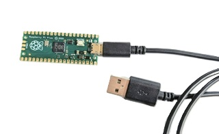
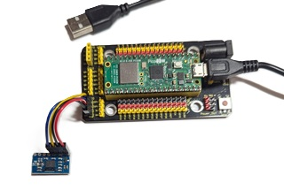
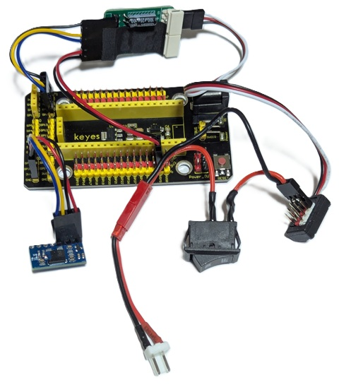
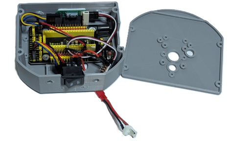
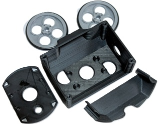
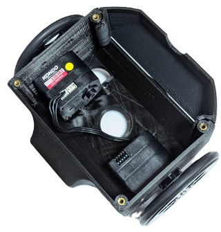

### Beginners Python couse
# 自律走行ロボット（倒立振子）プログラミング講座
### Raspberry Pi Pico × MicroPython 自律走行ロボット（倒立振子）プログラミング講座
### 〜 GY-BNO055姿勢センサとKRSモータを制御して、倒れないロボット作りに挑戦しよう！ 〜

## 第2回開催日	2026年11月14日（土）13:00スタート
### 使用機材(2回)  Raspberry Pi Pico + USBケーブル + pico拡張ボード+BNO055、ご自宅のWindows11-PC（インターネット接続,Gemini,Thonnyインストール済み) 

[教材用の電子回路はこちらをご参照ください。](https://github.com/nishibra/ROBO-ONE_Beginners_auto/blob/main/Electronic_Circuit.md)

[倒立伸子の動画](https://www.youtube.com/shorts/Del15TIizIo)

---

## ■ 概要

| 項目 | 内容 |
| :--- | :--- |
| **受講料** | 無料（教材はご準備ください / オンライン開催） |
| **開催方法** | オンライン（Zoom） ※ご自宅から安心して受講いただけます |
| **開催日程** | 2026年10月〜2027年1月（3ヶ月間 / 月2回程度） |
| **講義時間** | 土曜日 2時間  |
| **第2回開催日** | 2026年11月14日（土）13:00スタート |
| **対象レベル** | 小学生高学年 〜 高校生向け入門講座（プログラミング未経験・初心者歓迎！） |
| **使用機材(2回)** | Raspberry Pi Pico + USBケーブル + 汎用ボード+BNO055、ご自宅のWindows11-PC（インターネット接続,Gemini,Thonnyインストール済みのこと) |

---

## ■ カリキュラム構成（全6回 / 3ヶ月間）

### 【第1回終了】 【準備編】Pico超入門 と プログラミングのきほん（10月17日（土）10:00-12:00）
* Zoomでのオンライン受講方法と環境チェック、Thonny（ソニー）の使い方マスター
* MicroPythonの基本（数字・計算・「もし〜なら」・「くりかえし」）
* オンボードLEDをプログラミングでピカピカ光らせる「Lチカ」ミッション！

### 教材

-----

#### 第1回講座概要
まずGoogle Geminiをインストールします。次にThonnyをインストールし、起動後MicroPythonとpicoの起動ファイルをインストールします。
ポイントは以下のインストール画面の設定です。お持ちのpicoと同じvariantを設定してください。

[インストール画面](pics/inst_mcpython.png)

Lチカのプログラム以降は動画をご覧ください。なおPythonコードはリポジトリーに上げました。s1_07_Lchika.pyなど参照ください。

[講座動画](https://youtu.be/fTwlqjTaRik)

### 【第2回】 高性能IMUセンサ（GY-BNO055）でロボットの「へいこうかんかく」を測ろう！（11月14日（土）13:00-15:00）
* 本格9軸センサ GY-BNO055 の特徴とI2C通信での接続方法
* センサ内部のフュージョン機能を使って「正確な傾き角度（オイラー角）」を即座に取得
* Picoを傾けるとパソコン画面の角度表示が滑らかに反応するリアルタイム実験

### 教材 
(picoは第一回で使用したもの。何でもよい。imuと拡張ボードは接続してご準備してください。)

### 【第3回】 ロボットの足（KRSサーボモータ）を自由自在に動かそう！（12月上旬（土）予定）
* 普通のモータとサーボモータの違い（指定した角度でピッタリ止まる仕組み）
* シリアル通信（UART）を使って、Picoからモータへ「○度へ動け」と命令送信
* モータを首振りのように滑らかに往復運動させるプログラムを作成

### 【第4回】 たったまま倒れない「コントロールの魔法（PID制御）」（12月下旬（土）予定）
* 「手のひらでほうきを立てる遊び」から、比例(P)・積分(I)・微分(D)の感覚を直感体験
* 傾きにあわせてモータをどちらへどれくらい回すか計算するバランス計算プログラム作成
* 画面上のシミュレーション画面で、画面の中のロボットを立たせるテスト

### 【第5回】 ぜんぶ合体！はじめての倒立（とうりつ）テスト（1月中旬（土）予定）
* 1秒間に100回（10ms周期）正確に計算をまわすタイマー
* GY-BNO055センサ読み取り → バランス計算 → モータ出力の一連ループを合体して実機テスト！
* 倒れそう（±45度超）になったら自動でモータを止める「転倒安全ブレーキ」の組込

### 【第6回】 倒れないロボット完成！ふんばりコンテスト＆オンライン発表会（1月下旬（土）予定）
* パラメータ（P・I・Dの強さ）を調整して一番シャキッと立つベストな数値を捜索
* 手でちょんと押しても倒れずに起き上がってくる「おきあがりこぼし」調整
* Zoom画面越しに手放しで何秒立ちつづけられるかタイムアタック＆発表会！

---

## ■ご準備について

* **【受講方法】** ZoomミーティングURLは事前にお送りします。氏名/年齢/保護者氏名/e-mailをお知らせください。
* **【ご家庭でご用意いただくもの】** インターネットに接続できるパソコン（Windows11）※Webカメラ・マイク
* **【教材】**
  * **第2回以降:** Raspberry Pi Pico、GY-BNO055姿勢センサ、KRSモータ、接続ケーブル類など
  * ご要望があればセットを準備します。お問い合わせください。

---

[ROBO-ONE Beginners公認ロボット](https://kondo-robot.com/archives/22223)

<ご購入方法>

[KXR-R2K ローバー型K（自律タイプ）](https://store.shopping.yahoo.co.jp/robotyuenchi/ko-213.html)

[KXR-R2B ローバー型B（操縦タイプ）](https://store.shopping.yahoo.co.jp/robotyuenchi/ko-212.html)

### 今後使用するの教材(ご要望がありましたのでセットを準備しました。)
2回以降の講座から使用する教材を準備しました。CPU/バッテリー/サーボモーはご自身でご準備ください。

KXR-R2K ローバー型K（自律タイプ）をお持ちの方は以下の電子回路が搭載できます。

#### [B001] 電子回路セット(￥6,600.-税込、送料込み、講座参加者価格)

拡張ボード /IMU/サーボドライバー/サーボハブ/スイッチ/電源コネクター付き

KXR-R2B ローバー型B（操縦タイプ）をお持ちの方はケース付きセットに交換するだけでautoに変更できます。または新規に制作を考えている方はケース付きをご利用ください。

#### [B002] ケース付き電子回路セット(￥9,900.-税込、送料込み、講座参加者価格)

ケースは以下のサイトのCpu_pico_case v49.stlとCpu_pico_cover v29.stlを3Dプリンターでプリントしたものです。自作できる方はご自身で製作してください。

[3Dプリンター用データ](https://github.com/nishibra/ROBO-ONE_Beginners_auto/blob/main/stl)

### お勧めの足回り

倒立伸子のサーボにはKRS-3300シリーズのすべてのサーボモーターを使用できると同時にバッテリー(Lipoバッテリー2セル/7.4Vなど)は自由に自己責任で使用できます。
サーボモータについては通常KRS-3301を使用しますが、倒立伸子で初段を目指すにはKRS3304-R2を使用します。KRS3301でも本講座は受講できます。
またバッテリーにLipoバッテリー2セル/7.4Vを使用する場合容量により大きさや形状が異なるため、それに対応すべくボディ形状を対応させるべく製作したVisionAI用のものを使うのが良いでしょう。

[VisionAIの足回り](https://github.com/nishibra/ROBO-ONE_Beginners_VisionAI/blob/main/pics_mech/body.jpg)

[VisionAIのgithub](https://github.com/nishibra/ROBO-ONE_Beginners_VisionAI/tree/main)

足回りの[3D-printerデータ](https://github.com/nishibra/ROBO-ONE_Beginners_VisionAI/tree/main/stl)は以下の3点です。自作できる方はご自身で製作してください。

- Body_V.stl
- Battery_cover.stl
- Wheel_V.stl

#### [B003] ボディとタイヤセット(￥3,850.-税込、送料込み、講座参加者価格)

#### [B004] KRS3304-R2 2個付き(3台のみ￥19,800.-税込、送料込み、講座参加者価格)

[KRS3304-R2購入先例](https://www.amazon.co.jp/%E8%BF%91%E8%97%A4%E7%A7%91%E5%AD%A6-KRS-3304R2-ICS-03170/dp/B07L9R7RRZ/ref=sr_1_2?__mk_ja_JP=%E3%82%AB%E3%82%BF%E3%82%AB%E3%83%8A&crid=33GXWWQHG03G&dib=eyJ2IjoiMSJ9.LZUnOhAWhfCJK529DqYDRqmXrbQAtKx7jJ4YkE528QQ.BsNpjtyCu7rzeW5qvjg3ULSh65zp3afxTcH096B4XGU&dib_tag=se&keywords=krs3304r2&qid=1792827191&sprefix=krs3304r2%2Caps%2C197&sr=8-2&ufe=app_do%3Aamzn1.fos.35785624-70c4-44ae-a5c3-3f044f475d63)

